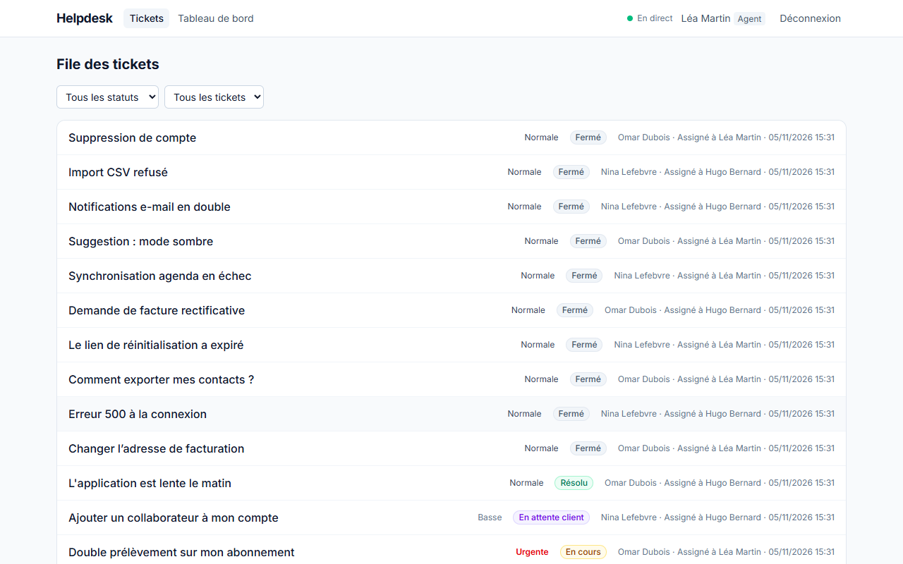
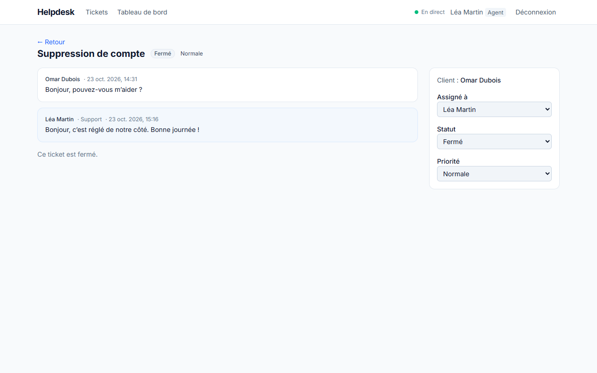
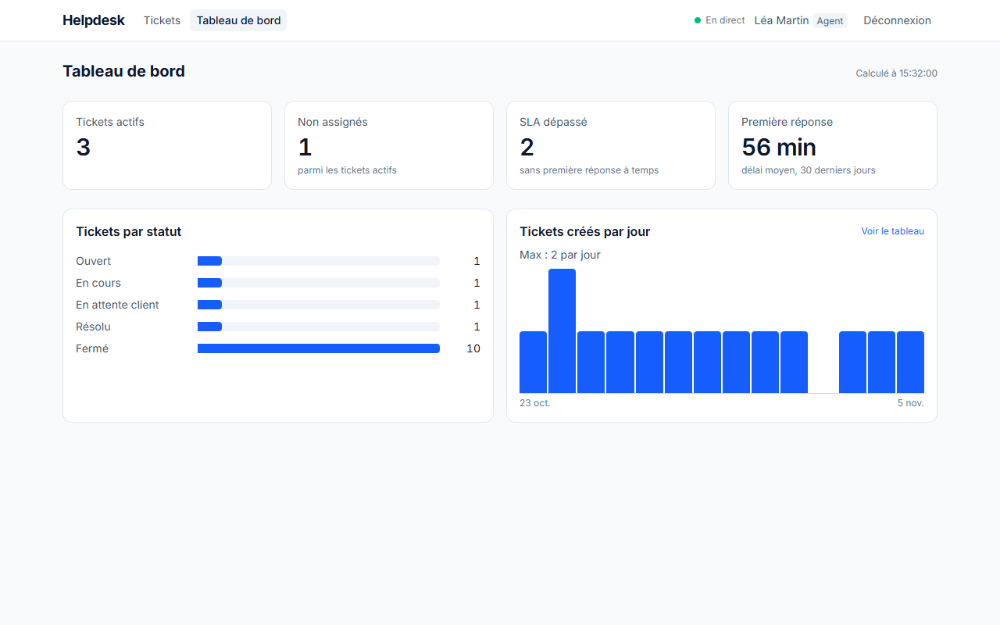
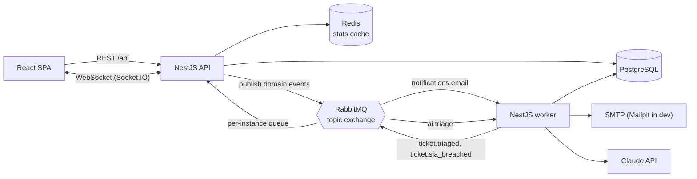

# Helpdesk

A customer-support ticketing app: clients open tickets, agents answer them in real time,
an event-driven worker sends e-mails and watches response-time SLAs, and Claude (Anthropic)
triages new tickets and drafts replies.

Built as a portfolio project to show production-minded full-stack work: an event-driven
architecture, real-time updates, caching, access control, and tests at every layer.



| Ticket conversation (agent view) | Staff dashboard |
|---|---|
|  |  |

## Features

- **Three roles**: clients see only their own tickets; agents work the whole queue; admins manage users.
- **Ticket lifecycle**: assignment, statuses that follow the conversation (an agent reply waits
  for the customer, a customer reply goes back to the agent), priorities, internal notes hidden from clients.
- **Real-time**: new tickets and replies appear instantly for the right people (WebSocket), with toasts.
- **E-mail notifications** sent by a background worker (confirmation, new reply, ticket resolved, assignment).
- **SLA monitoring**: tickets without a first answer in time are flagged and admins are alerted.
- **Dashboard**: active / unassigned / late tickets, average first-response time, 14-day trend.
- **AI (Claude)**: automatic category, suggested priority and one-line summary for each new ticket;
  one-click reply drafts for agents. Optional: the app runs fully without an API key.
- **One-click demo accounts** on the login page (client, agent, admin).

## Architecture



- The **API** writes to PostgreSQL, then publishes a domain event (`ticket.created`,
  `message.created`, ...) to a RabbitMQ topic exchange. Events carry ids only; consumers reload fresh data.
- The **worker** is a separate process (same codebase, different entry point) so slow work
  (SMTP, LLM calls) never slows HTTP requests, and both scale independently.
- **Reliability**: manual acks, a retry queue with a TTL (5 s, 3 attempts), then a dead-letter
  queue; consumers are idempotent because RabbitMQ delivers at least once.
- **Real-time**: each API instance consumes every event from its own temporary queue and pushes
  it to its connected browsers, so scaling out needs no Socket.IO Redis adapter. The socket only
  says "ticket X changed"; the browser refetches through REST, so access rules live in one place.
- **Dashboard** aggregates are computed in SQL and cached in Redis (cache-aside, 60 s TTL,
  invalidated on every ticket event).

## Tech stack

| | |
|---|---|
| Back end | TypeScript, NestJS 12, Prisma 6, PostgreSQL 17 |
| Messaging | RabbitMQ 4 (amqplib + amqp-connection-manager) |
| Real-time / cache | Socket.IO, Redis 7 (ioredis) |
| Front end | React 19, Vite, TanStack Query, React Router, Tailwind CSS 4 |
| AI | Claude via `@anthropic-ai/sdk`, structured outputs validated with Zod |
| Auth | argon2id password hashing, JWT in an httpOnly cookie, role guards |
| Quality | Vitest (unit + e2e on real services), oxlint, GitHub Actions |
| Ops | Docker multi-stage images, nginx, Docker Compose |

## Run it

Requirements: Node 24, Docker.

**Everything in containers** (quickest):

```bash
docker compose --profile app up --build
# first run only, in another terminal: demo accounts and tickets
docker compose exec api node dist/seed.js
```

Open http://localhost:8080 and use a demo button (password `demo-password`).
E-mails land in Mailpit at http://localhost:8025, RabbitMQ's UI is at http://localhost:15672 (helpdesk / helpdesk).

**Development** (hot reload):

```bash
npm run infra:up                       # Postgres, Redis, RabbitMQ, Mailpit
cp apps/api/.env.example apps/api/.env # then set JWT_SECRET (and ANTHROPIC_API_KEY to enable AI)
cd apps/api && npm ci && npx prisma migrate dev && npx prisma db seed && cd ../..
cd apps/web && npm ci && cd ../..
npm run dev:api    # http://localhost:3000
npm run dev:worker
npm run dev:web    # http://localhost:5173
```

**Tests** (need `npm run infra:up`):

```bash
cd apps/api
npm test            # unit tests: business rules, e-mail rules, routing, AI parsing
npm run test:e2e    # HTTP + WebSocket against real Postgres, Redis and RabbitMQ
```

## Design decisions and trade-offs

- **httpOnly cookie instead of a token in localStorage**: XSS cannot steal the session;
  `sameSite=lax` blocks cross-site POSTs. Trade-off: no revocation before expiry (1 day).
  Next step: short-lived access token + refresh token, or a Redis deny-list.
- **Secure by default**: authentication and role guards are global; routes opt out with `@Public()`.
  Row-level access (`visibleTicketsWhere`) is applied to every ticket query; another client's
  ticket returns 404, not 403, so its existence is not revealed.
- **Business rules as pure functions** (`tickets.policy.ts`, `email-rules.ts`, `audience.ts`):
  unit-tested in milliseconds, services stay thin.
- **Publish after commit**: if the process dies between the DB write and the publish, the event is lost.
  The production fix is the transactional outbox pattern (write events in the same transaction, relay them).
- **AI as suggestions, not decisions**: triage never changes the ticket's priority by itself.
  Ticket text is treated as untrusted data in prompts, output is schema-constrained and validated,
  AI fields are hidden from clients, refusals are not retried, transient API errors are.
- **Offset pagination**: simple and enough here; cursor pagination would scale better.

## Project structure

```
apps/api/src
  auth/          register, login, JWT cookie, guards, decorators
  tickets/       controller, service, pure policy rules
  events/        RabbitMQ connection, topology, publisher, idempotency
  notifications/ e-mail rules + consumer (worker)
  sla/           SLA cron job (worker)
  ai/            Claude client, triage schema + consumer (worker)
  realtime/      Socket.IO gateway, event audience rules
  stats/         dashboard queries + Redis cache
  main.ts        HTTP API entry point
  worker.ts      worker entry point
apps/web/src     React pages, TanStack Query hooks, real-time hook
```

See [DEPLOY.md](DEPLOY.md) to host it on a small VPS.
